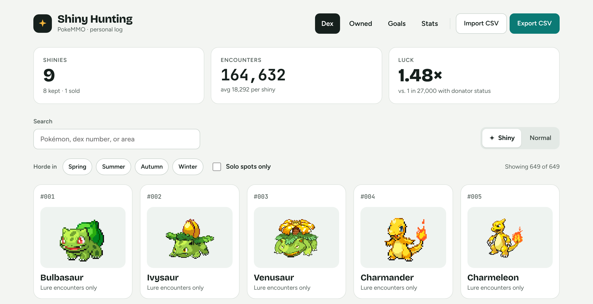

<h1 align="center">✦ Shiny Hunt Tracker</h1>

  My PokeMMO shiny log: what I own, what I'm hunting next, and a dex to plan from. 
  <a href="https://mcui1997.github.io/shiny-hunting/"><b>Open the site →</b></a>

  

- **Home** – totals and a tier list: Owned, Hunting, S, A, B
- **Owned** – every catch; open one for its battle screenshot, details and a note
- **Dex** – all 649 Pokémon with filters for final forms, unowned and missing
- **Species pages** – abilities, uses, stats, and the best 5x horde per season
- **Stats** – luck against 1 in 27,000 (donator), encounters per shiny, and net worth

All data lives in `public/data/tracker.json`. Edit on the site, export, and commit.

Game data from <a href="https://github.com/PokeMMO-Tools/pokemmo-hub">PokeMMO Hub</a> · sprites from <a href="https://github.com/PokeAPI/sprites">PokeAPI</a>
